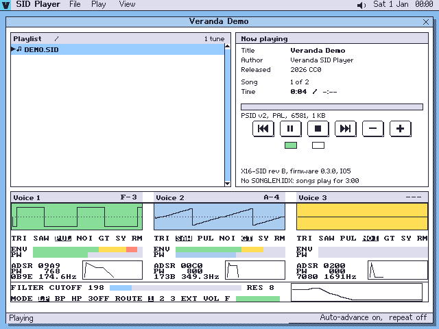
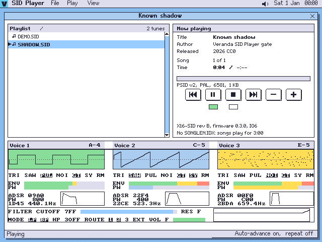
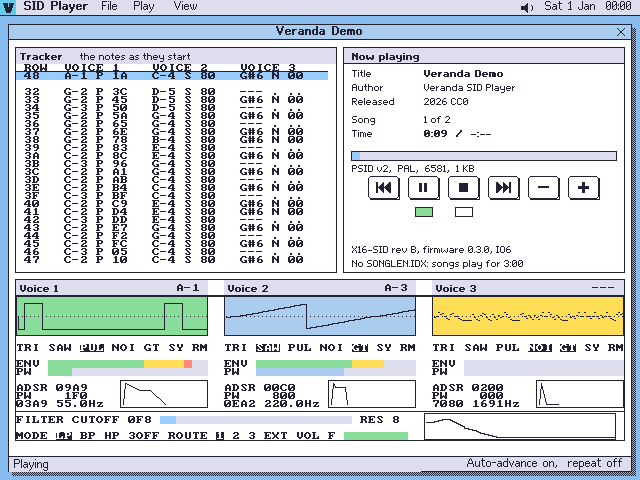

# Veranda SID Player

SID tunes on the **X16-SID** card's real SID, from **Veranda**, the GEOS-style
desktop for the Commander X16. A port of the CommanderSID project's player
(`SIDPLAY.PRG`) to a native Veranda application. GPL-3.0-or-later (NOTICE,
COPYING).

 

## What it does

- **Veranda Look 2** (Veranda's DECISIONS V74, V77, V79): the kernel's menu
  bar (the Veranda mark, the program's name first, the menus in the UI
  font, the clock and the speaker at the right, open menus on the theme's
  highlight colour) and the SDK's window chrome (`vrwin.h`: the title band
  on the theme's accent, titled with the tune's name, its close glyph at
  the right; the status bar; a frame and the dither shadow; compiled into
  the player's overlay 3) over the desk's colour, in Look 2's palette,
  light or dark; the shell shows the player's own tile (`src/tile.txt`).
- **Menus:** SID Player (about, the desk accessories), File (Open... with
  Veranda's Open dialog, `vr_file`, its `.sid` files by their long names,
  compiled into the player's overlay 2; find the card, quit), Play
  (play/pause, stop, next and previous tune, next and previous song,
  auto-advance, repeat: off, folder, song), View (playlist, tracker).
- **The playlist:** the folder's folders (first) and `.sid` files, by name;
  double click (or Return) opens a folder or plays a tune; `..` goes up;
  a scroll bar, the wheel, the arrow keys, Page Up/Down, Home, End.
- **Now playing:** title, author, released, song x of y, the time and the
  song's length (HVSC's song lengths through `SONGLEN.IDX`, looked for in
  the tune's folder, the card's root and the player's folder), a progress
  bar, PSID/RSID, PAL/NTSC, 6581/8580, the size; the transport icons
  (previous tune, play/pause, stop, next tune, song -, song +) and their
  lights; the card (rev, firmware, IO5 or IO6).
- **Auto-advance** to the next song, then the next tune, when a song's
  time is up (3:00 when SONGLEN.IDX does not know it); **repeat** the
  folder or the song.
- **The voices,** from the card's register shadow: a scope per voice, the
  note, the waveform's bits, the envelope and the pulse width as bars, ADSR
  as a graph, the frequency; the filter (cutoff and volume bars, mode,
  routing, its response as a curve). **The tracker view:** the notes as
  they start, three voices.
- **RSID tunes** run on the card's C64 (C64 mode, headless), as with
  SIDPLAY.PRG: they need `C64ROMS.BIN` (your own ROM images, made by
  CommanderSID's `tools/c64roms`) in the card's root or the player's
  folder. No ROM is part of this repository.
- **Opens `.sid` files from the shell** (`documents = SID`), long names
  too (`dataLongName`, API 5).
- **No card:** "No X16-SID card found" (IO5 and IO6 are tried), and the
  folders can still be browsed.

Keys: Space play/pause, Right/Left (or N/P) next/previous tune, + and -
song, 1-9 a song, Esc or S stop, A auto-advance, R repeat, T tracker,
Backspace up a folder, Alt+O open, Alt+Q or Q quit.

## The card

The card answers at IO5 (`$9FA0`) or IO6 (`$9FC0`); the player tries IO5,
then IO6. Its mailbox (`$9FBD`, the status `$9FBF`) carries frames of
LEN, CMD, payload, CRC-8: STORE the file into the card's store, MD5 of it
(for SONGLEN.IDX), PLAY a song (or C64_SID for an RSID), PAUSE, STOP. The
card's player runs the tune on the real SID; the X16 only reads the
registers back (the card's shadow) to draw them. The card answers reads
while armed: Veranda's interrupt renews the lease every frame
(`intFirstVector`, which dialog boxes leave alone), and the player lets it go when it quits.

## Building

    make vsdk     # Veranda's SDK, kernel and shell from ~/Projects/geos (a copy)
    make          # build/app/SID Player.cvt (and the log build in build/log)
    make emu      # the emulator with the card model (tools/mkemu.sh)
    make gate     # tools/gate_veranda.sh

`CC65_HOME` defaults to `~/.local/share/cc65`. On the SD card: `SID
Player.cvt` beside the shell in `/VERANDA`; the tunes anywhere;
`SONGLEN.IDX` (CommanderSID's `tools/songlengths/mksongidx.py`, or
`tools/mksongidx.py` here) in the card's root.

## The gate

There is no card in the emulator, so the gate uses the CommanderSID
project's own card model: its emulator patches with its firmware core (the
mailbox, the PSID player, the C64 mode, reSIDfp), merged with the
`-mousescript` branch in x16emu's branch `sidcard`
(`~/Projects/x16-emulator-sidcard`, `tools/mkemu.sh`). Every session is
played by a mouse script through the emulated PS/2 mouse; the card's log
(`-sidlog`) is decoded into its requests (`tests/sidlog.py`), and the
voices' panel is read back from VRAM (`tests/check_ui.py`). See the
comment at the top of `tools/gate_veranda.sh`.
